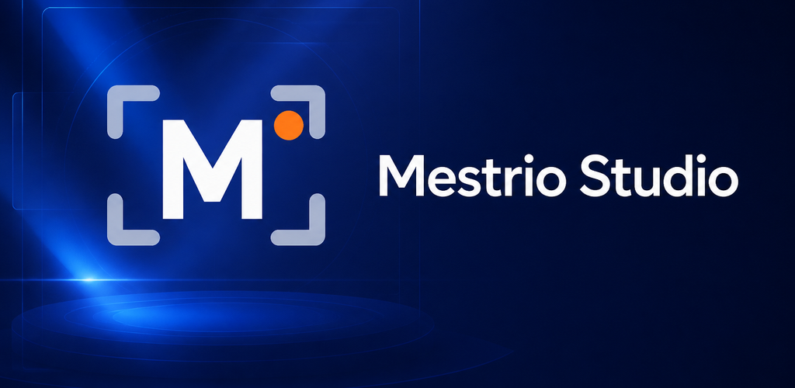
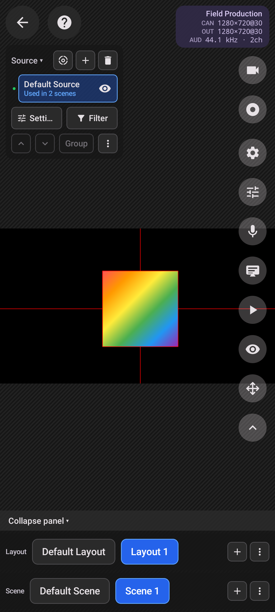
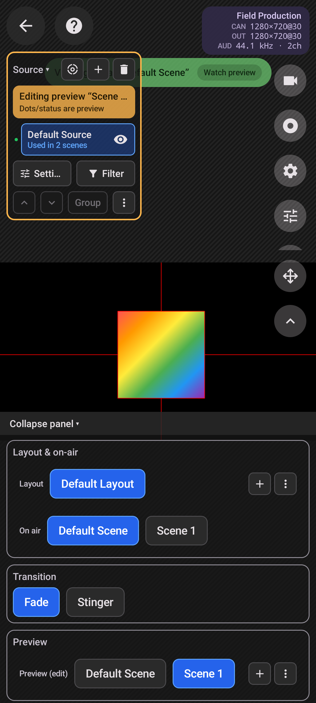
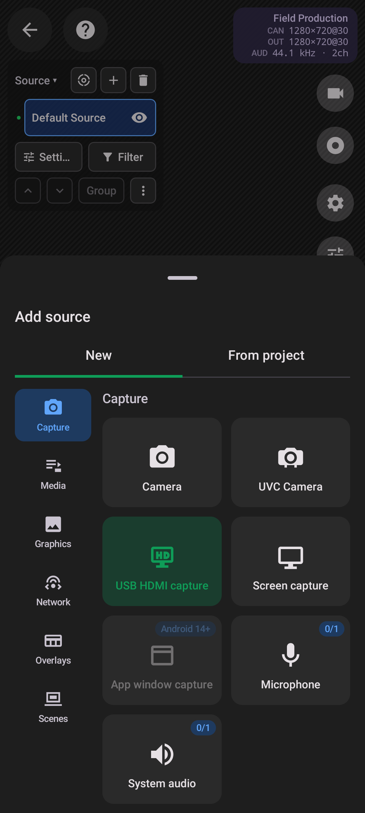
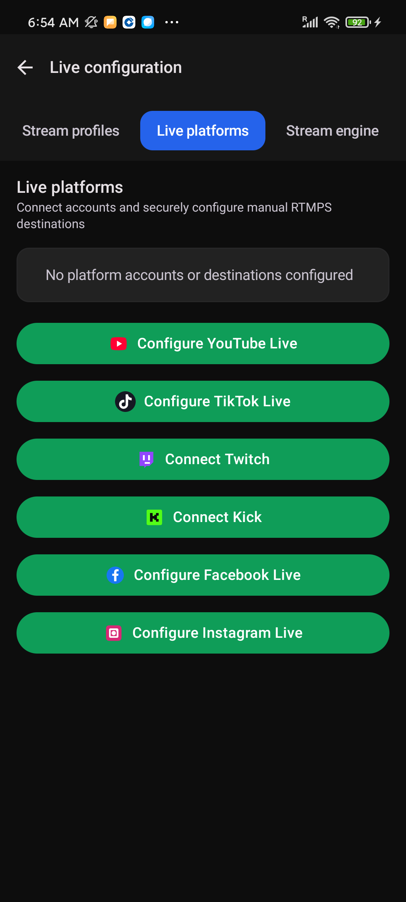
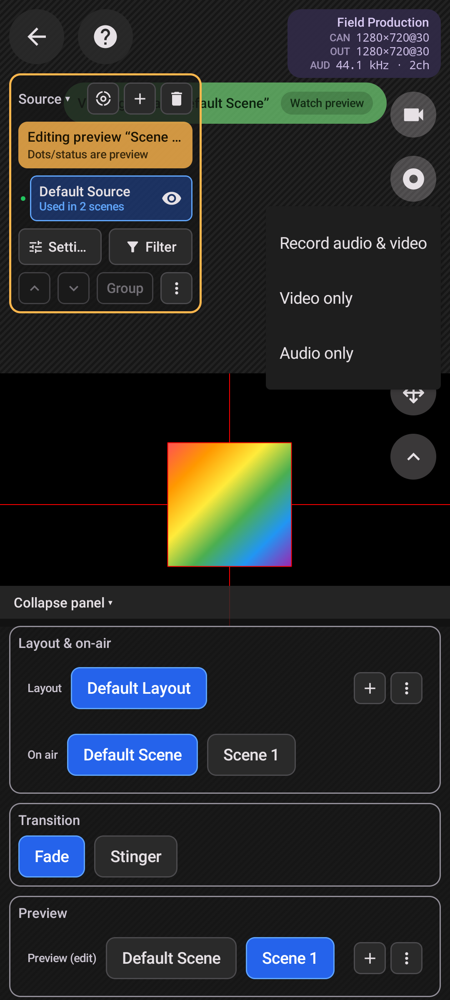
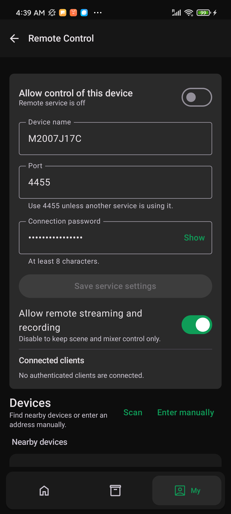
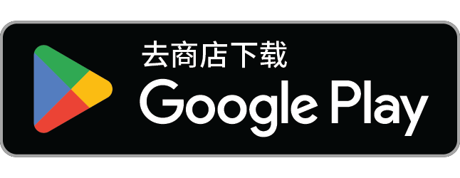

# Mestrio Studio — Live Streaming & Recording Studio for Android

Create a live show on your Android device: combine cameras and media, switch scenes, mix audio, stream to multiple destinations, and record locally. Mestrio Studio brings a familiar OBS-style production workflow to a phone or tablet, with touch controls built for work on location.

[Read the full English story](https://mestrio-studio.web.app/blog/studio-production/) · [简体中文](#简体中文)

## Make the show before you go live

Build **scenes** for the opening, presenter, demonstration, and closing. Within a scene, create **layouts** for a full-screen camera, split interview, or screen share with a picture-in-picture host. Reuse a source across scenes while giving each appearance its own position and size. Choose your canvas shape and output resolution, frame rate, bitrate, and audio settings to suit the event and your device.

When it is time to switch, use a Cut, Fade, Slide, Zoom, Wipe, Circle Open, Stinger, or other available **transition**. **Studio Mode** gives you separate Program and Preview views: prepare the next scene and layout, check it, then take it live. For repeated segments, **Auto Director** can advance through timed scene and layout cues.

## Bring in the sources you need

Open **Source → + → New** to add a feed. A few useful starting points:

| Source | When to use it |
| --- | --- |
| **Camera / Screen capture** | Put the presenter on camera or show an Android app demonstration. |
| **UVC Camera** | Connect a compatible USB webcam to a device with USB Host/OTG, grant Android's USB permission, and select the camera in the source settings. |
| **USB HDMI capture** | Bring a camera or camcorder into the show through a compatible USB capture card; select USB audio separately when needed. |
| **Media playlist / Video / Audio / Image** | Queue an opener, play a product clip, add music, or display graphics. |
| **Network stream / Stream server** | Receive a remote stream by address, or let another device push a feed into the phone's stream server. |
| **NDI / Browser** | Bring in a feed from the local NDI network or add a web overlay and dashboard. |

Keep logos, clips, audio, SVG, Lottie, and subtitle files in **Resources** so they are ready for another project. Add an existing source *from the project* when you want to use the same camera or file in another scene.

## Sound and picture, under control

The **Mixer** gives each audio source its own level, mute, meter, and local monitoring control. Add audio filters such as noise suppression, EQ, compression, and limiting where a source needs them. Video filters cover color, LUTs, crops, masks, keying, blur, and more; apply them to a source, one scene appearance, a group, or a whole scene as appropriate.

## Stream and record on your terms

Configure available destinations for **YouTube Live, TikTok Live, Twitch, Kick, Facebook Live, Instagram Live**, or a custom server, then send the same Program output to several destinations. See connection status for each destination alongside live frame rate, bitrate, and duration. Custom workflows can use supported RTMP(S), RTSP(S), SRT, and WebRTC engines.

**Recording** can run alone or alongside streaming. Choose video with audio, video only, or audio only (MP4 for video; M4A for audio only). Share the live encode to conserve device resources, or give the recording separate encoding settings when you need a different local file.

## Fit into a larger production

Use **NDI** to receive a local network feed or send Program video and audio to another production device; Preview video can also be sent separately. Under **My → Remote Control**, connect to another Mestrio Studio device or a PC running OBS Studio with OBS WebSocket enabled. From the phone, switch scenes, trigger transitions, manage sources, and control streaming or recording. Mestrio Studio devices can also be controlled by scene layout.

If you already use desktop OBS Studio, scenes, sources, and Program/Preview will feel familiar. Mestrio Studio is useful when the production moves to a classroom, trade show, shop floor, or interview location—and the phone can still work with a larger OBS setup.

## A look inside / 界面预览

| Scenes and layouts / 场景与布局 | Studio Mode / 导播预览 | Sources and UVC / 来源与外接摄像头 |
| :---: | :---: | :---: |
|  |  |  |

| Live destinations / 推流平台 | Recording / 录制模式 | Remote control / 遥控器 |
| :---: | :---: | :---: |
|  |  |  |

## Get started

1. [Install Mestrio Studio from Google Play](https://play.google.com/store/apps/details?id=com.mestrio.studio).
2. Create a project and choose its canvas and output settings.
3. Add a scene, connect your sources, and set up a second layout.
4. Check the Mixer and Preview, then make a short recording before the live event.
5. Add your streaming destinations and go live when everything is ready.

Feature availability depends on the Android device, version, connected hardware, network, and app plan. Platform streaming also requires the relevant account permissions and stream credentials.

---

## 简体中文

### 把导播台带到现场

**Mestrio Studio** 是一款 Android 直播与录制应用。用手机或平板接入摄像头、屏幕和网络画面，编排场景、混音、预览下一镜，同时推流到多个平台并在本地录制。熟悉 PC OBS 的用户会认出场景、Source 和 Studio Mode；到了教室、展会、门店或采访现场，则可以直接用触控完成制作。

[查看英文长文与更多配图](https://mestrio-studio.web.app/blog/studio-production/)

### 从场景、布局开始搭节目

把片头、主持人、演示和结束画面分别放进**场景**；同一个场景可准备全屏、双人分屏、画中画等**布局**，切布局时不必重建 Source。常用的摄像头可以跨场景复用。项目设置里可按横屏或竖屏等用途选择画布，并调整分辨率、帧率、码率和音频参数。

打开 **Studio Mode** 后，Program 保持播出，Preview 用来准备下一镜。确认画面与布局后，再用 Cut、Fade、Slide、Zoom、Wipe、Circle Open 或 Stinger 等**转场**切出。无人值守或固定流程的节目，可以让**自动演播 Auto Director** 按设定时间轮播场景和布局。

### Source 不止手机镜头

从 **Source → + → New** 添加来源：

| 来源 | 用法 |
| --- | --- |
| **Camera / Screen capture** | 拍摄主持人，或演示手机上的操作。 |
| **UVC Camera** | 在支持 USB Host/OTG 的设备上接入兼容 USB 摄像头，授予 USB 权限后在来源设置中选择设备。 |
| **USB HDMI capture** | 通过兼容采集卡接入微单或摄像机；需要声音时再选择 USB 音频输入。 |
| **Media playlist / Video / Audio / Image** | 排好片头、产品视频、配乐和图片的出场顺序。 |
| **Network stream / Stream server** | 从地址拉取远端画面，或让其他设备把流推入手机上的接收服务。 |
| **NDI / Browser** | 使用局域网中的 NDI 信号，或添加网页叠层、实时看板。 |

Logo、视频、音频、SVG、Lottie 和字幕等文件可以先存进**资源库 Resources**，下个项目继续使用。同一来源要放进另一场景时，选择从当前项目添加即可。

### 让观众听清，也让画面统一

**Mixer 混音器**可分别调整麦克风、音乐、视频和网络声音的音量、静音与本地监听，并查看实时电平。音频滤镜可做降噪、均衡、压缩和限幅；视频滤镜可做调色、LUT、裁切、遮罩、抠像与模糊。滤镜可以按来源、来源在某场景中的一次出场、组合或整个场景来使用。

### 多端推流，同时留下录制文件

先配置可用的 **YouTube Live、TikTok Live、Twitch、Kick、Facebook Live、Instagram Live** 或自定义服务器，再把同一份 Program 画面与主混音送往多个目的地。界面分别显示各路连接状态、直播时长、帧率与码率。自定义链路还可使用相应引擎支持的 RTMP(S)、RTSP(S)、SRT 和 WebRTC。

**录制**可单独进行，也能和推流同时运行。音视频、纯视频、纯音频三种模式分别适合整场回放、后期配音和访谈音频；视频保存为 MP4，纯音频保存为 M4A。录制可共用推流编码以节省设备负担，也可设独立编码参数。

### 接入其他设备，或用手机遥控

**NDI** 既能把局域网信号作为 Source 接进来，也能把 Program 画面与声音发送给其他制作设备，Preview 画面可单独输出。进入 **My → Remote Control**，手机可连接另一台 Mestrio Studio 或开启 OBS WebSocket 的 PC OBS，远程切场景、触发转场、管理来源以及控制推流和录制；连接 Mestrio Studio 时还能切换布局。

### 开始使用

1. [从 Google Play 安装 Mestrio Studio](https://play.google.com/store/apps/details?id=com.mestrio.studio)。
2. 新建项目，设置画布和输出参数。
3. 添加场景与 Source，给常用场景准备第二套布局。
4. 在 Mixer 和 Preview 中检查声音、画面，先录一小段回看。
5. 配好直播目的地，再正式开播。

功能可用性取决于 Android 版本、设备、外接硬件、网络与应用方案。向平台推流还需要相应账号权限和串流信息。

---

**Download / 下载：** [Mestrio Studio on Google Play](https://play.google.com/store/apps/details?id=com.mestrio.studio)  
**Full article / 完整文章：** [Take the Control Room With You](https://mestrio-studio.web.app/blog/studio-production/)
